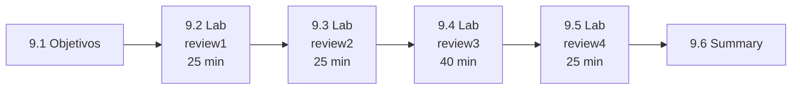

# Capítulo 9 — Comprehensive Review

**Título em português:** Revisão geral
**Status:** ✅ documentado e validado (documentação; os labs são marcados por você no checklist)
**Referência:** PDF p. 570–615 · arquivo `AU294_AAP2.6_C09_Revisao_Geral_p570-615.pdf` (não versionado)

## Objetivo do capítulo

Validar os conhecimentos adquiridos no curso AU294 com labs integrados.

## Por que este capítulo importa

Os labs de revisão trazem só **especificações** e um **tempo indicado**, sem passos:
é o ensaio mais próximo de um exame prático. Concluí-los no tempo, sem consultar
soluções, é o critério de prontidão do curso.

## Seções e atividades (ordem oficial)

| Seção | Tipo | Título original | Material | PDF |
|-------|------|-----------------|----------|-----|
| 9.1 | Summary | Summary of Learning Objectives | [mapa de objetivos](9.1-mapa-de-objetivos.md) | p. 571–573 |
| 9.2 | Lab | Deploying Ansible | [prática](PRATICA-OFICIAL.md#92-lab-deploying-ansible) | p. 574–586 |
| 9.3 | Lab | Creating Playbooks | [prática](PRATICA-OFICIAL.md#93-lab-creating-playbooks) | p. 587–594 |
| 9.4 | Lab | Managing Linux Hosts and Using System Roles | [prática](PRATICA-OFICIAL.md#94-lab-managing-linux-hosts-and-using-system-roles) | p. 595–605 |
| 9.5 | Lab | Creating Roles | [prática](PRATICA-OFICIAL.md#95-lab-creating-roles) | p. 606–614 |
| 9.6 | Summary | Summary | [RESUMO.md](RESUMO.md) | p. 615 |

A abertura do capítulo está na p. 570. Não há seções conceituais nem quiz; os quatro
labs aceitam `lab grade`.

## Arquivos do capítulo

- [9.1-mapa-de-objetivos.md](9.1-mapa-de-objetivos.md): objetivos de todos os capítulos ligados às lições, para autoavaliação.
- [PRATICA-OFICIAL.md](PRATICA-OFICIAL.md): ponte com os quatro labs, cobertura e tempos.
- [REVISAO.md](REVISAO.md): simulado autoral integrado (19 itens).
- [RESUMO.md](RESUMO.md): fechamento do curso e próximos passos.
- Exemplo validado: [exemplos-originais/cap09-revisao-integrada](../../exemplos-originais/cap09-revisao-integrada/).

## Checklist (marcado por você)

- [ ] 9.1 mapa de objetivos todo marcado
- [ ] 9.2 Lab `comprehensive-review1` com `lab grade` aprovado (≤ 25 min)
- [ ] 9.3 Lab `comprehensive-review2` com `lab grade` aprovado (≤ 25 min)
- [ ] 9.4 Lab `comprehensive-review3` com `lab grade` aprovado (≤ 40 min)
- [ ] 9.5 Lab `comprehensive-review4` com `lab grade` aprovado (≤ 25 min)
- [ ] [REVISAO.md](REVISAO.md) (simulado) feito
- [ ] Registro no [diário de laboratórios](../../progresso/diario-de-laboratorios.md)

---
[← Capítulo 8](../08-administracao-linux/README.md) | [Índice geral](../../README.md) | [Próximo: 9.1 Mapa de objetivos →](9.1-mapa-de-objetivos.md)
