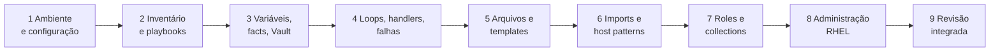

# Resumo — Capítulo 9 e fechamento do curso

Síntese autoral. Correspondência oficial: seção 9.6 Summary (PDF p. 615).

## O que o Capítulo 9 faz

| Seção | Ideia central |
|-------|---------------|
| 9.1 | Lista os objetivos de todos os capítulos para conferência antes da revisão ([mapa autoral](9.1-mapa-de-objetivos.md)) |
| 9.2–9.5 | Quatro labs por especificação, com tempo indicado e `lab grade`, cobrindo ambiente, playbooks, administração com system roles e roles |
| 9.6 | Concluídos os labs no tempo indicado, o curso sugere considerar o exame **EX294** e, para ir além (escala, orquestração, otimização), o curso **AU374** |

## O curso em uma página

| Capítulo | Leve para o exame |
|----------|-------------------|
| 1 | `ansible.cfg` (precedência de arquivos), `ansible-navigator.yml`, EE, development container |
| 2 | Inventário INI (grupos, `:children`, ranges), plays, `become`, `--syntax-check`, leitura do `PLAY RECAP` |
| 3 | Precedência de variáveis, `group_vars`/`host_vars`, facts e facts customizados, `hostvars`, Vault |
| 4 | `loop`, `when`, handlers e `force_handlers`, `block`/`rescue`/`always`, `failed_when`/`changed_when` |
| 5 | Módulos de arquivo (dono, modo, `setype`), templates com `for`/`if`/filtros, `ansible_managed` |
| 6 | `import_playbook`/`import_tasks` × `include_tasks`; patterns com `,`, `&`, `!`, curingas; `--limit` |
| 7 | Estrutura de role, `defaults` × `vars`, `import_role`/`include_role`, `requirements.yml`, FQCN/FQRN |
| 8 | System roles (`selinux`, `timesync`, `storage`, `network`, `rhc`), `dnf`, repositórios, usuários e sudo, cron/at, reboot |

## Hábitos que valem em qualquer lab

- Comece pelo projeto: `ansible.cfg`, inventário, conectividade.
- Um playbook por especificação; `--syntax-check` antes de executar; execute e confira no host.
- Reexecute para provar idempotência (`changed=0`).
- Leia a mensagem de erro por camada: YAML → módulo/parâmetro → variável → conexão/privilégio → host.
- Use `ansible-navigator doc` para módulos e o README das roles para variáveis.
- Nomes de arquivos, tasks e variáveis exigidos fazem parte da avaliação: siga a especificação ao pé da letra.

## Próximos passos

1. Marcar o [mapa de objetivos](9.1-mapa-de-objetivos.md) e fazer os quatro labs no tempo indicado.
2. Resolver o [simulado autoral](REVISAO.md).
3. Seguir o [roteiro de revisão para o EX294](../../certificacao-ex294/roteiro-de-revisao.md) e conferir os objetivos públicos atuais do exame.

---
[← Revisão](REVISAO.md) | [Índice do capítulo](README.md) | [Certificação EX294 →](../../certificacao-ex294/roteiro-de-revisao.md)
