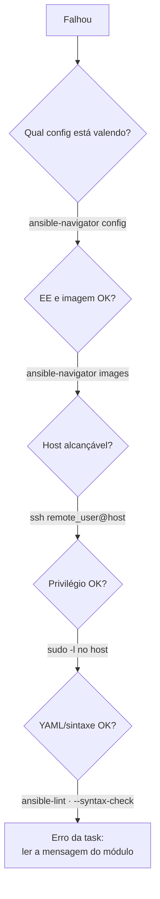

# Troubleshooting — sintoma → causa → verificação

Cobertura atual: **Capítulos 1 a 7** (ambiente, configuração, inventário, playbooks, conexão). Ampliado a cada capítulo.

## Roteiro geral (do mais externo ao mais interno)

## Configuração

| Sintoma | Causa provável | Verificação / correção |
|---------|----------------|------------------------|
| Mudança no `ansible.cfg` ignorada | `ANSIBLE_CONFIG` exportada ou diretório errado | `env \| grep ANSIBLE_`; `ansible-navigator config` (coluna *Source*) |
| Aviso *world writable directory* (📘) | Diretório do projeto com permissão `o+w` | `chmod o-w <dir>` |
| VS Code e terminal se comportam diferente | Extensão × `ansible-navigator.yml` divergentes | Iguale as duas configurações |

## Execution environment e containers

| Sintoma | Causa provável | Verificação / correção |
|---------|----------------|------------------------|
| `unauthorized` ao baixar imagem | Falta login no registry | `podman login <registry>` |
| `x509: certificate signed by unknown authority` | Registry autoassinado | Laboratório: `--tls-verify=false`; produção: confiar na CA |
| Baixa a imagem toda vez | `pull.policy: always` | Use `missing` |
| Erro sobre engine | Engine configurado não instalado | `podman --version`; ajuste `container-engine` |
| Arquivos `*-artifact-*.json` acumulando | Artefatos habilitados (padrão) | `playbook-artifact.enable: false` |

## Conexão e privilégio

| Sintoma | Causa provável | Verificação / correção |
|---------|----------------|------------------------|
| `UNREACHABLE` + `Permission denied (publickey...)` | Chave pública ausente para o `remote_user` | `ssh-copy-id <user>@<host>` |
| Tentou conectar como `root` | `remote_user` não definido (no EE) | Defina `remote_user` |
| `UNREACHABLE` + `Could not resolve hostname` | DNS/nome do inventário | `getent hosts <host>` no control node |
| `Host key verification failed` | Chave de host desconhecida ou mudou | Confirme a identidade do host e atualize `known_hosts` |
| `Missing sudo password` | `sudo` com senha e `become_ask_pass = false` | `NOPASSWD` no host ou `become_ask_pass = true` |
| Prompt de senha não aparece / trava | Modo interativo ou artefatos ligados | `-m stdout --pae false` |

## Inventário (Cap. 2)

| Sintoma | Causa provável | Verificação / correção |
|---------|----------------|------------------------|
| `You must pass a single valid host to --host parameter` | Nome diferente do gerado (zero à esquerda, domínio) | `--graph` e compare |
| Aviso de host e grupo com o mesmo nome | Host e grupo homônimos (não permitido) | Renomeie o grupo |
| `No inventory was parsed, only implicit localhost` | Caminho errado ou arquivo inválido | `-i`/`inventory=` e avisos de parse |

## Playbooks (Cap. 2)

| Sintoma | Causa provável | Verificação / correção |
|---------|----------------|------------------------|
| `Syntax Error while loading YAML` / `mapping values are not allowed` | Falta espaço após `:`, indentação, tab | Linha indicada **e a anterior** |
| `couldn't resolve module/action '<fqcn>'` | FQCN errado ou collection ausente no EE | `ansible-navigator doc -l`; usar EE com a collection |
| `changed` em toda execução | `command`/`shell`/`raw` ou `state: latest` | Módulo específico; `creates`/`removes`; `present` |
| `Could not find or access '<arquivo>'` | `src` com nome ou caminho errado | Caminho relativo ao playbook / `files/` |
| Lint acusa `yaml[octal-values]`, `fqcn[...]`, `no-free-form` | Octal sem aspas, nome curto, `chave=valor` | Corrija; não silencie a regra |
| `UNREACHABLE` com usuário inesperado na mensagem | `ansible_user` > `remote_user` (play) > `ansible.cfg` | `--host <h>` e `-vvvv` |

## Variáveis, facts e Vault (Cap. 3)

| Sintoma | Causa provável | Verificação / correção |
|---------|----------------|------------------------|
| `...looks like it might be an issue with missing quotes` | Valor começa com `{{` sem aspas | `"{{ var }}"` |
| `'x' is undefined` | Variável não definida para o host ou nome digitado errado | `inventory --host <h>`; `grep -Rw x:` |
| Valor inesperado | Outro nível da precedência vence | Percorra: `-e` → task → play → facts → host_vars → host → group_vars → grupo |
| `ansible_local` vazio | `.fact` com nome/formato errado ou sem recoleta | `.fact` em INI/JSON; `ansible.builtin.setup` depois de criar |
| `ansible_hostname` indefinido | `inject_facts_as_vars = false` | `ansible_facts['hostname']` |
| YAML inválido em `gather_subset` | `!x` sem aspas | `"!x"` |
| `Attempting to decrypt but no vault secrets found` | Senha não fornecida | `--ask-vault-pass`, `--vault-password-file`, `--vault-id`, `ansible.cfg` |
| `Decryption failed (no vault secrets were found that could decrypt)` | Senha errada ou vault ID ausente | `head -1 <f>` mostra o rótulo |
| Segredo na saída | Falta `no_log: true` | Adicione nas tasks sensíveis |

## Controle de tarefas (Cap. 4)

| Sintoma | Causa provável | Verificação / correção |
|---------|----------------|------------------------|
| `'item' is undefined` | `loop` dentro dos parâmetros do módulo | `loop` no nível da task |
| Task sempre `skipping` | Condição nunca verdadeira | `debug` dos valores comparados |
| `r['stdout']` inexistente após loop | Resultados em `r['results']` | `r['results'][N]['stdout']` |
| Handler não roda | Task `ok`, nome diferente no `notify`, ou falha antes do fim do play | Nome exato; `force_handlers` |
| Teste logo após mudança falha | Handlers só no fim do play | `ansible.builtin.meta: flush_handlers` |
| Playbook verde, mas algo faltou | `ignore_errors` escondendo falha | `failed_when`/`rescue` |
| `command` sempre `changed` | Natureza do módulo | `changed_when` |

## Arquivos e templates (Cap. 5)

| Sintoma | Causa provável | Verificação / correção |
|---------|----------------|------------------------|
| `copy` não acha a origem | Origem no host sem `remote_src: true`, ou caminho fora do projeto | `remote_src: true`; caminhos relativos ao projeto |
| Diretório copiado dentro de outro | `src` sem barra final | `src: dir/` copia só o conteúdo |
| `lineinfile` duplica a linha | Faltou `regexp` | `regexp` casando a linha existente |
| `lineinfile` falha (arquivo inexistente) | Padrão é falhar | `create: true` |
| Blocos se sobrescrevem | Mesmo marcador em dois `blockinfile` | `marker`/`marker_begin`/`marker_end` próprios |
| `synchronize` falha | `rsync` ausente em um dos lados | Instale `rsync` |
| Template não encontrado | Fora de `templates/` | Ajuste `src` |
| Variável indefinida no template | Não definida para o host | Defina ou use `default(...)` |
| Fact vazio no template | `gather_facts: false` | Colete facts |

## Imports, includes e host patterns (Cap. 6)

| Sintoma | Causa provável | Verificação / correção |
|---------|----------------|------------------------|
| Falha antes de começar citando arquivo importado | Arquivo inexistente ou com erro | Caminho relativo ao arquivo que importa; `--syntax-check` |
| Erro com `import_playbook` | Usado dentro de um play | Só no nível superior |
| Loop/variável dinâmica em `import_tasks` não funciona | Import é resolvido no parse | `include_tasks` |
| Tasks não aparecem no `--list-tasks` | Arquivo incluído (dinâmico) | Esperado; use import se precisar |
| Erro de YAML em `hosts:` | Pattern com `!`, `*`, `&` sem aspas | Aspas |
| IP não casa | IP não listado no inventário | Liste o IP ou use o nome |
| Curinga atinge hosts demais | Casa também grupos e IPs | `--list-hosts`; pattern mais específico |

## Roles e collections (Cap. 7)

| Sintoma | Causa provável | Verificação / correção |
|---------|----------------|------------------------|
| `the role 'x' was not found` | Role fora de `roles/`/`roles_path` ou instalada em `~/.ansible/roles` | `ansible-galaxy role list`; `-p roles` ou `roles_path` |
| `couldn't resolve module/action` | Collection fora do `collections_path` | `ansible-navigator collections list`; `-p collections` |
| Task antes de `roles:` roda depois | Seção `roles` sempre roda antes de `tasks` | `import_role`/`include_role` em `tasks` |
| Valor do play ignorado pela role | Variável em `vars/main.yml` da role | Parâmetro em `roles:` ou mover para `defaults` |
| Template/arquivo da role não encontrado | Fora de `templates/`/`files/` da role | Mover; `src` é relativo à role |
| Playbook quebrou após reinstalar roles | Versão não fixada no requirements | `version` com tag ou commit |
| Versão inesperada da collection | Ordem do `collections_path` | Projeto antes da imagem |

## Development container e Git

| Sintoma | Causa provável | Verificação / correção |
|---------|----------------|------------------------|
| *Reopen in Container* não aparece | Notificação expirou | Ícone de janela remota › *Reopen in Container* |
| Dev Containers tenta usar Docker | Extensão não configurada | *Docker Path* `podman`, *Docker Compose Path* `podman-compose` |
| `git push` rejeitado | Remoto à frente | `git pull`, resolva conflitos, `git push` (sem `--force`) |
| Commit com autor errado | Identidade não configurada | `git config --global user.name/user.email` |

---
[← Configuração](configuracao-ansible-e-navigator.md) | [Índice geral](../README.md) | [Glossário →](glossario.md)
