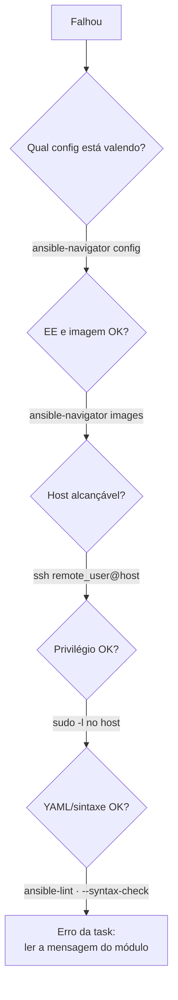

# Troubleshooting — sintoma → causa → verificação

Cobertura atual: **Capítulo 1** (ambiente e configuração). Ampliado a cada capítulo.

## Roteiro geral (do mais externo ao mais interno)

## Configuração

| Sintoma | Causa provável | Verificação / correção |
|---------|----------------|------------------------|
| Mudança no `ansible.cfg` ignorada | `ANSIBLE_CONFIG` exportada ou diretório errado | `env \| grep ANSIBLE_`; `ansible-navigator config` (coluna *Source*) |
| `config file = None` e aviso *world writable directory* | Diretório do projeto com permissão `o+w` | `chmod o-w <dir>` |
| Erro de tipo em valor numérico/booleano | `#` no meio da linha do `ansible.cfg` | Use `;` ou comentário em linha separada |
| `connection = ...` sem efeito | Chave errada no `ansible.cfg` | Use `transport = ...` |
| VS Code e terminal se comportam diferente | Extensão × `ansible-navigator.yml` divergentes | Iguale as duas configurações |

## Execution environment e containers

| Sintoma | Causa provável | Verificação / correção |
|---------|----------------|------------------------|
| `unauthorized` ao baixar imagem | Falta login no registry | `podman login <registry>` |
| `x509: certificate signed by unknown authority` | Registry autoassinado | Laboratório: `--tls-verify=false`; produção: confiar na CA |
| Baixa a imagem toda vez | `pull.policy: always` | Use `missing` |
| Erro sobre engine | Engine configurado não instalado | `podman --version`; ajuste `container-engine` |
| Arquivos `*-artifact-*.json` acumulando | Artefatos habilitados (padrão) | `playbook-artifact.enable: false` |

## Conexão e privilégio

| Sintoma | Causa provável | Verificação / correção |
|---------|----------------|------------------------|
| `UNREACHABLE` + `Permission denied (publickey...)` | Chave pública ausente para o `remote_user` | `ssh-copy-id <user>@<host>` |
| Tentou conectar como `root` | `remote_user` não definido (no EE) | Defina `remote_user` |
| `UNREACHABLE` + `Could not resolve hostname` | DNS/nome do inventário | `getent hosts <host>` no control node |
| `Host key verification failed` | Chave de host desconhecida ou mudou | Confirme a identidade do host e atualize `known_hosts` |
| `Missing sudo password` | `sudo` com senha e `become_ask_pass = false` | `NOPASSWD` no host ou `become_ask_pass = true` |
| Prompt de senha não aparece / trava | Modo interativo ou artefatos ligados | `-m stdout --pae false` |

## Development container e Git

| Sintoma | Causa provável | Verificação / correção |
|---------|----------------|------------------------|
| *Reopen in Container* não aparece | Notificação expirou | Ícone de janela remota › *Reopen in Container* |
| Dev Containers tenta usar Docker | Extensão não configurada | *Docker Path* `podman`, *Docker Compose Path* `podman-compose` |
| `git push` rejeitado | Remoto à frente | `git pull`, resolva conflitos, `git push` (sem `--force`) |
| Commit com autor errado | Identidade não configurada | `git config --global user.name/user.email` |

---
[← Configuração](configuracao-ansible-e-navigator.md) | [Índice geral](../README.md) | [Glossário →](glossario.md)
